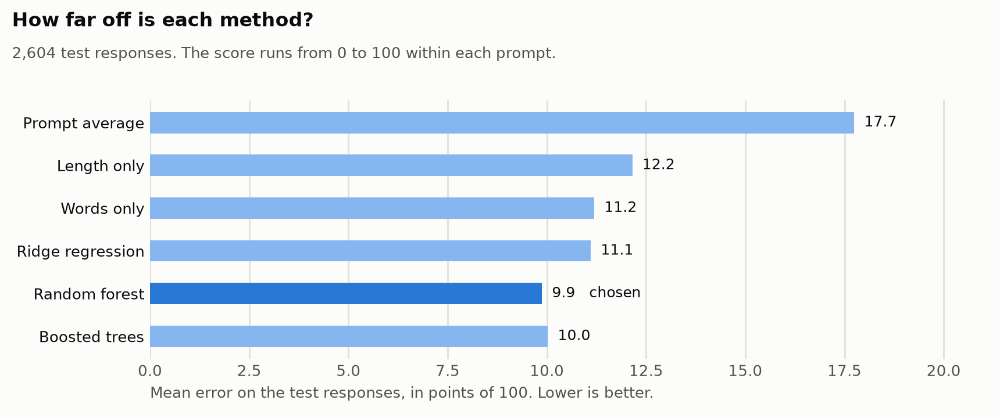
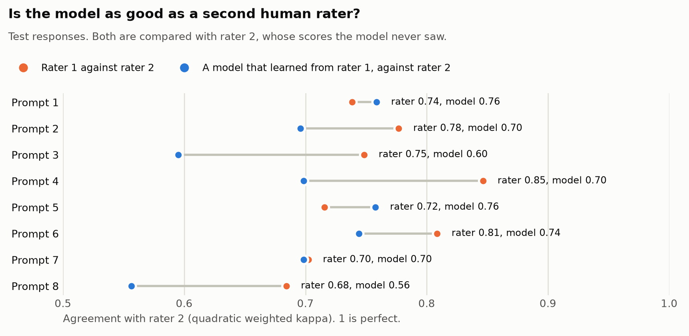
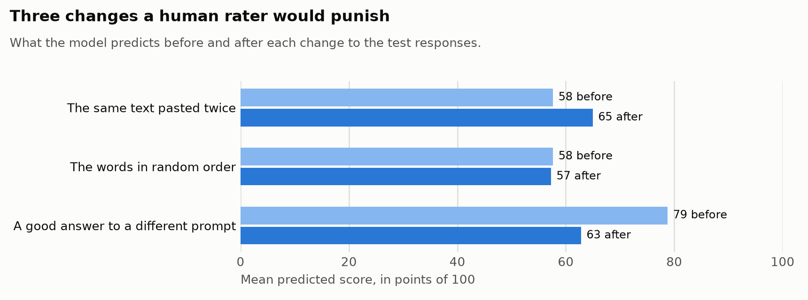

# Scoring Written Assessment Responses

A portfolio project on public data. It predicts the score a trained human rater gives to a written response, from features of the text, and then asks four questions a scoring model should be able to answer: how good is the label, where are the errors, can the model be fooled, and does it work on an assessment it has never seen.

Built in November 2026 with Claude as the coding assistant. No employer's data, code or results are in it. Nothing is deployed. It is sized as a small project: one data file, 20 features, six methods, about 3 minutes to run.

## What this is

| | |
|---|---|
| The job | Given a written response to an assessment prompt, predict the score a trained rater would give it |
| Data | The Automated Student Assessment Prize file of 2012: 12,976 essays by school students on 8 prompts, each scored by two trained raters |
| What it stands in for | Any scored written assessment. The writers are students, not job candidates, and the prompts are essay questions, not job simulations |
| The target | The final score, put on a 0 to 1 scale within its prompt. It is a number, so this is regression |
| Methods compared | The prompt's average, length alone, the words alone, and three models on 20 hand-made features: ridge regression, a random forest, boosted trees |
| The split | 7,797 responses to learn from, 2,571 to choose on, 2,604 for the test. Five-fold cross-validation inside the training part |
| Not in it | No hiring data. No fairness analysis: the file has no information about the writers. No neural network. Nothing deployed |

## The result in six lines

1. On 2,604 test responses the chosen model, a random forest, is off by 9.9 points of 100 on average. Length alone is off by 12.2, and the prompt's average by 17.7.
2. It gives exactly the raters' final score on 55.1% of test responses, against 46.8% for length alone. That is 8.3 percentage points, or 18% in relative terms. The two figures describe one result and are not interchangeable.
3. The label itself is noisy. The two raters gave the same score on 61.7% of test responses, and two response texts that were filed twice got two different final scores.
4. The model is not yet a second rater. A model that learned from rater 1 agrees with rater 2 at a kappa of 0.688. Rater 1 agrees with rater 2 at 0.753.
5. It can be fooled. Pasting a response twice raises the predicted score for 93% of responses. Putting the words in random order changes almost nothing: 57.6 to 57.3 points.
6. On a prompt it has never seen, agreement falls from 0.746 to 0.538.



## How it works

Five scripts, run in order.

| Step | Script | What it does | Time on 2 cores |
|---|---|---|---|
| 1 | `01_get_data.py` | Downloads one file (16 MB) and checks it against its fingerprint | Seconds |
| 2 | `02_prepare.py` | Prepares the data in SQL: duplicates, score scale, split, rater agreement | Seconds |
| 3 | `03_models.py` | Cross-validates six methods, chooses one, scores all six on the test part | About 1.5 minutes |
| 4 | `04_checks.py` | The label, the errors, three probes, a prompt never seen | About 1.5 minutes |
| 5 | `05_report.py` | Three charts and the headline numbers | Seconds |

Steps 2, 3 and 4 each write a report in `results/`: `prepare.md`, `models.md`, `checks.md`.

## Step 2: the data, prepared in SQL

The SQL is in `sql/`, one file per job, and runs in DuckDB, a database that lives inside the Python process. Python reads the file, because its text is in an old Windows encoding, and SQL does the rest.

| File | What it does | SQL it uses |
|---|---|---|
| `01_load.sql` | The raw rows into a typed table, and the score range of each prompt | Casts, a values table |
| `02_duplicates.sql` | Finds response texts filed more than once, two ways, and keeps the first copy | `GROUP BY` with `HAVING`, and `row_number()` over a partition |
| `03_score_and_split.sql` | Puts every score on a 0 to 1 scale within its prompt. Splits into train, tune and test, and numbers five folds | A join, `avg()` and `percent_rank()` over a partition, a fingerprint of the id |
| `04_rater_agreement.sql` | How often the two raters agree, per prompt, and how the final score follows from their two scores | Conditional averages, `corr()`, `least()` and `greatest()` |

Three things came out of this step.

- **4 response texts are in the file twice.** Both ways of finding them agree. They are removed before the split, so the same text cannot sit on both sides of it. 12,972 responses are left.
- **2 of those 4 texts were given two different final scores.** The same words, scored on different occasions, got different marks. That is the first sign of how noisy the label is.
- **The split does not depend on row order or on the machine.** It comes from a fingerprint of the response id.

| Prompt | Score scale | Responses | Raters gave the same score | Within one point |
|---|---|---|---|---|
| 1 | 2 to 12 | 1,783 | 65.3% | 98.8% |
| 2 | 1 to 6 | 1,800 | 78.3% | 99.8% |
| 3 | 0 to 3 | 1,724 | 74.8% | 99.7% |
| 4 | 0 to 3 | 1,768 | 77.1% | 99.9% |
| 5 | 0 to 4 | 1,805 | 58.0% | 98.0% |
| 6 | 0 to 4 | 1,800 | 62.3% | 98.5% |
| 7 | 0 to 30 | 1,569 | 29.2% | 60.7% |
| 8 | 0 to 60 | 723 | 27.8% | 48.1% |

The raters of prompts 7 and 8 score on wider scales, so an exact match is rarer there.

Two more facts about the label, both in `results/prepare.md`.

- **The final score is not formed the same way on every prompt.** In the file it is the two raters added up on prompts 1 and 7 and on 84% of prompt 8, rater 1's score on prompt 2, and the higher of the two on 97% to 100% of prompts 3 to 6.
- **The published scales are used as given.** Prompt 7 is published as 0 to 30, but no final score in the file is above 24. Prompt 8 is published as 0 to 60, and the lowest in the file is 10. So a point of 100 is a point of the published scale.

## The features

20 features in three groups. Each can be traced from the raw text to something a rater could see.

| Group | Features | Examples | What a rater would call it |
|---|---|---|---|
| Structure | 7 | Words, sentences, words per sentence, commas per 100 words | How much was written and how it is built |
| Language | 10 | Different words, letters per word, share of long words, share of uncommon words, linking words, masked names | Vocabulary and care |
| Content | 3 | How much the wording resembles the top quarter of training responses on the same prompt, and the bottom quarter | Whether it answers this prompt |

Two rules keep them honest.

- **No feature reads a score.** The content features need to know which training responses were good. For a training response, those groups are rebuilt without the response itself. Otherwise the feature would carry the response's own score into the model. A test proves it: change one response's score, and its own content features do not move.
- **Each feature is put on the scale of its own prompt.** A 300-word answer is long for one prompt and short for another. So every feature becomes a distance from that prompt's training average, in standard deviations.

One trace, from raw text to feature. The response begins "Dear local newspaper, I think effects computers have on people are great learning skills". `surface()` in `features.py` strips the publisher's masks, finds the words, and counts: 341 words, 16 sentences, 4.2 letters per word. `WithinPrompt` then turns 341 words into "a little under average for prompt 1", where the training responses average 359.

## Step 3: six methods, one choice

| Method | Mean error, points of 100 | R squared | Same final score | Agreement (kappa) |
|---|---|---|---|---|
| Prompt average | 17.75 | 0.087 | 31.0% | 0.000 |
| Length only | 12.16 | 0.531 | 46.8% | 0.622 |
| Words only | 11.20 | 0.598 | 48.7% | 0.619 |
| Ridge regression | 11.11 | 0.611 | 49.8% | 0.690 |
| **Random forest (chosen)** | **9.88** | **0.670** | **55.1%** | **0.746** |
| Boosted trees | 10.03 | 0.672 | 54.1% | 0.746 |

Test part, 2,604 responses. Agreement is quadratic weighted kappa against the final score, averaged over the 8 prompts: 1 is perfect, 0 is chance.

**How the choice was made.**

1. Five-fold cross-validation on the training part ranked the methods. Everything learned from data, the features included, was learned again inside each fold. The forest came first at 9.83 points, the boosted trees second at 9.92. The spread between folds is 0.2 points, so those two are a tie.
2. The tuning part settled one question with an interval: does the forest beat the plain ridge regression by more than chance? It cut the mean error by 1.20 points, with a 95% interval from 1.00 to 1.41. The interval is clear of zero, so the forest was kept.
3. All six methods were then scored on the test part. The choice was made in steps 1 and 2 and does not look at it.

The settings of each method are written by hand in `scoring.py` and no search over them was run: 300 trees with at least 5 responses per leaf for the forest, 300 rounds for the boosted trees, a penalty of 10 for the ridge regression. They are not the library's defaults.

**Length is most of it.** Length alone gets from 17.7 to 12.2 points. The other 19 features and a forest add 2.3 more (95% interval 2.0 to 2.6). A baseline has to be this strong before a gain over it means anything.

**Two ways to state the gain, and why it matters.** The share of test responses given exactly the raters' final score goes from 46.8% to 55.1%. That is 8.3 percentage points, or an 18% relative improvement. A resume line that says "improved accuracy by 18%" and one that says "by 8 points" describe the same result. A reader has to be told which one it is, and against which baseline.

`results/models.md` also shows what the forest leans on. Shuffling "how much more its wording resembles the top quarter than the bottom quarter" costs it 2.1 points, the number of different words 1.6, the number of words 1.1. One feature is there that I cannot defend: digits per 100 words costs 1.1 points when shuffled. It probably marks something specific to one prompt. I left it in and say so.

## Step 4: four checks

**A. How good is the label?**



The fair contest is this: train the model on rater 1's scores only, then compare it with rater 2, the same way rater 1 is compared with rater 2. The model reaches rater 1's level on 2 of 8 prompts. On average it is at 0.688 where rater 1 is at 0.753. And no model can be shown to be better than the raters by this measure, because where two raters disagree the data cannot say who is right.

**B. Where are the errors?**

| Actual score, within its prompt | Responses | Mean error | Mean signed error |
|---|---|---|---|
| Low scores | 1,225 | 10.09 | +5.84 |
| Middle scores | 893 | 8.47 | -2.55 |
| High scores | 486 | 11.92 | -11.25 |

The bands are cut at one third and two thirds of the score's rank within its prompt. Scores are whole numbers with many ties, so the bands are not equal in size: a response is in the high band when at least two thirds of the responses to its prompt scored lower.

The model pulls everyone toward the middle. Weak responses are scored 5.8 points too high and the best ones 11.2 points too low. For a tool that ranks people, that matters most exactly where decisions are made: at the top. 84 test responses are missed by 30 points or more. Errors are a little larger where the two raters disagreed (10.21 points against 9.67).

**C. Can it be fooled?**



| Probe | Mean predicted score before | After | Scored higher |
|---|---|---|---|
| The same text pasted twice | 57.6 | 65.0 | 93% |
| The words in random order | 57.6 | 57.3 | 36% |
| A good answer to a different prompt | 78.8 | 62.8 | 28% |

The third probe uses the 486 test responses in the high band.

The model counts. It does not read. Doubling the text raises the score, and scrambling the words costs nothing. It does notice an answer to the wrong question, through the content features, but still gives it 63 points. Nobody should score real people with this model without a person reading the response.

**D. A prompt it has never seen.** Trained on seven prompts and scored on the eighth, agreement falls from 0.746 to 0.538 and mean error rises from 9.5 to 13.4 points, both averaged over the eight prompts. A new prompt has no top and bottom responses to compare with, so the three content features are switched off, and the other features are scaled by the new prompt's own responses, which needs no scores. The ranking survives better than the level: the correlation with the true score stays between 0.58 and 0.84. A new assessment needs its own scored responses before this model can be trusted on it.

## Run it yourself

You need Python 3.12 or 3.13 and about 1 GB of free disk.

```
python -m venv .venv
.venv\Scripts\activate            (on a Mac or Linux: source .venv/bin/activate)
pip install -r requirements.txt

python tests/test_all.py

python 01_get_data.py
python 02_prepare.py
python 03_models.py
python 04_checks.py
python 05_report.py

python check_my_run.py
```

The whole run takes about 3 minutes on 2 cores. `check_my_run.py` compares the headline numbers of your run with the run this folder shipped with and lists any that differ. If a number differs a little, quote your own.

Read in this order: `sql/` (four short files), `02_prepare.py`, `features.py`, `tests/test_all.py`, `scoring.py`, `03_models.py`, `04_checks.py`. Then read the three reports in `results/` next to the code that wrote them.

## What each file is

| File | What it holds |
|---|---|
| `common.py` | Paths, the score scale of each prompt |
| `sql/` | The data preparation, four files |
| `features.py` | The 20 features, the out-of-fold rule, the within-prompt scale |
| `scoring.py` | The measures, the six methods, the object that turns text into a score |
| `01` to `05` | The five steps |
| `check_my_run.py` | Compares your run with the reference run |
| `06_seed_check.py`, `07_without_length.py` | My extension of November 24, 2026: the seed check and the forest without its length features |
| `DECISIONS.md` | The choices in this project: the situation, the options, the choice, the reason, what happened |
| `tests/test_all.py` | 15 checks. No data file needed |
| `data/manifest.json` | Source, license note and fingerprint of the data file |
| `results/` | Every report, chart and number of the reference run |
| `reference_run/summary.json` | The reference run's headline numbers, kept apart so a rerun does not overwrite them |

## My run (November 24, 2026)

I ran every step on my own machine: Windows, Python 3.13 and the pinned versions, from a fresh download checked against its fingerprint. Before the script ran, I ran each query of the four SQL files by hand in DuckDB.

`check_my_run.py` compares 165 numbers with the reference run. 158 are the same to nine digits. The other 7 all belong to the words-only baseline, whose solver works in steps and stops when it is close enough. They agree to six decimals: the largest gap is 0.00000012 points. Every number in this README is the same at the precision shown, so none was changed.

## My extension (November 24, 2026)

Two new files. Neither changes a file or a number above.

```
python 06_seed_check.py
python 07_without_length.py
```

**The seed check.** The interval in step 3 redraws the responses but holds the trained models fixed. So I grew the forest from five seeds. The first seed repeats step 3.

| Part | Gain over ridge regression, across five seeds | Lowest end of any 95% interval |
|---|---|---|
| Tune | 1.16 to 1.23 points | 0.96 |
| Test | 1.23 to 1.27 points | 1.01 |

The gain over ridge regression does not depend on the seed. The check also showed something step 3 did not: paired, the forest is ahead of the boosted trees by 0.13 to 0.20 points, with the interval clear of zero for 5 of 5 seeds on both parts. That is a small, steady edge with hand-set settings. Neither model was tuned, so it is not a claim that forests beat boosting.

**The forest without its length features.** How much of the model is length, and is it harder to fool without it? Three forests with the same settings and seed.

| Forest | Taken out | Mean error, test | Kappa | Cost against the full forest | Pasted twice: scored higher | Mean score before and after |
|---|---|---|---|---|---|---|
| Full, 20 features | Nothing | 9.88 | 0.746 | | 93% | 57.6 to 65.0 |
| 17 features | Words, their log, sentences | 10.03 | 0.738 | 0.15 (0.06 to 0.23) | 30% | 57.6 to 56.3 |
| 16 features | Those, and the number of different words | 10.98 | 0.699 | 1.10 (0.89 to 1.31) | 2% | 57.5 to 43.3 |

Length alone is at 12.16.

- The three size counts add 0.15 points of accuracy and are the whole reward for pasting a response twice.
- Length was also carried by the number of different words. Taking that out costs 1.10 points.
- With no length feature at all, the forest is still ahead of length alone. But pasting twice then lowers the score for 98% of responses, through a ratio feature. It still counts and does not read.

**What I decided.** The full forest stays as the benchmark, and every number above is its number. If this model were used, I would use the 17-feature forest and give up 0.15 points to remove most of the reward for padding. And I would use it as a second opinion only: a person scores every response, and the model flags the ones where it differs by a lot for another human look. The reasons and the conditions are in `DECISIONS.md`.

**Limits of the extension.** One training part and one way of adding length. The forest without length features was grown from one seed. The 17-feature forest was named after its test results were seen, and the test part was never sealed. The seed check changes only the forest's own random draws: the training responses are the same in every row.

## Limits

- **Students, not candidates.** The responses are school essays. The method carries over to any scored written assessment. The numbers do not.
- **The label is two people's judgment.** They agree exactly 62% of the time, and the final score is formed from their two scores in a different way on different prompts. A model trained on it inherits that noise, and its ceiling.
- **No fairness analysis.** The file says nothing about who wrote each response, so nothing here shows whether the model treats groups of writers alike. For a hiring use that question comes first.
- **The model rewards length and vocabulary.** The probes show it. It should not score a person without a human reading the response.
- **The test part was not sealed.** Step 3 scores all six methods on it and printed them on every run while the project was built. One feature was corrected after test results had already been printed: masked names were being counted as words in the longest sentence. The choice between methods is made by the code from cross-validation and the tuning part, and does not look at the test part.
- **No writer id.** The file does not say who wrote each response, so the split is by response and splitting by person could not be tested. If one student wrote for two prompts, the file cannot show it. Duplicated texts were the nearest thing that could be checked, and they were removed first.
- **Small and simple on purpose.** No language model reads the text. The "words only" row is a bag of words.
- **No open license is stated for the data.** It was released for a public competition in 2012. This project downloads it and does not redistribute it.
- **Nothing is deployed.**

## Sources

- Data: The Hewlett Foundation, Automated Student Assessment Prize, 2012: kaggle.com/c/asap-aes. The file is fetched from a public copy on Hugging Face (dataset `TasfiaS/ASAP-AES`) and checked against the fingerprint in `data/manifest.json`.
- Quadratic weighted kappa is the agreement measure the competition used.
